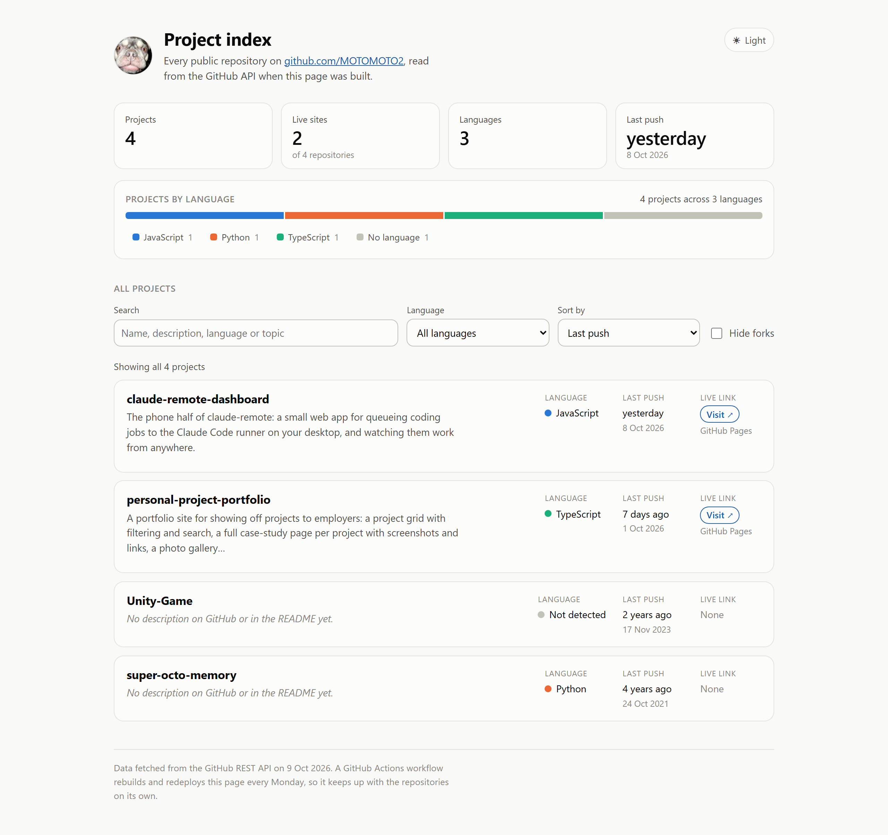
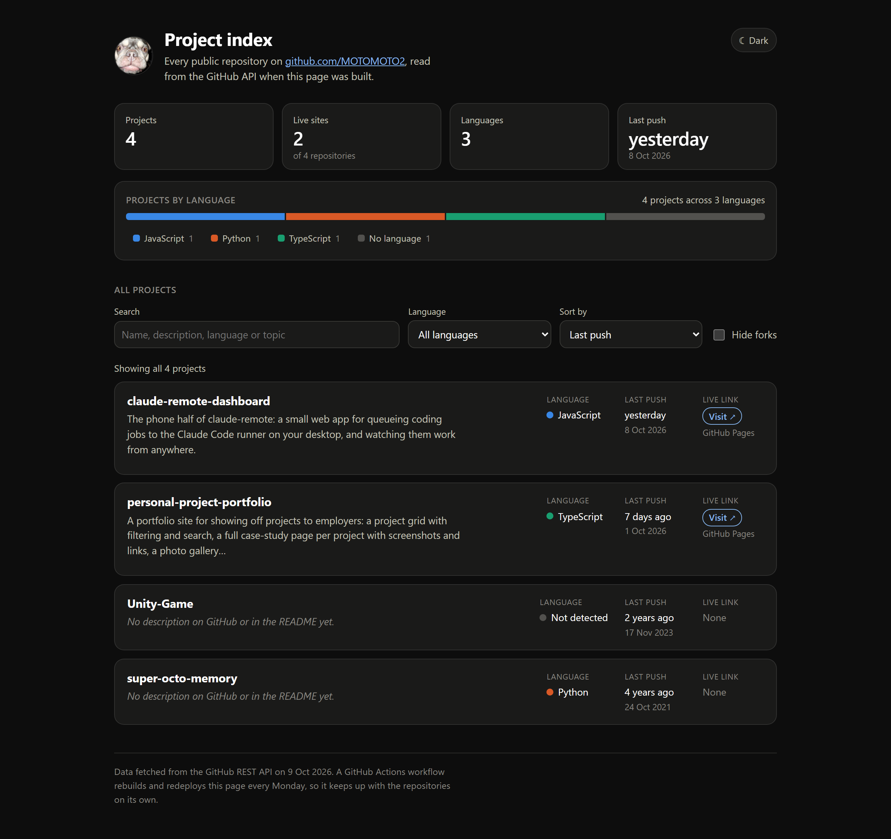
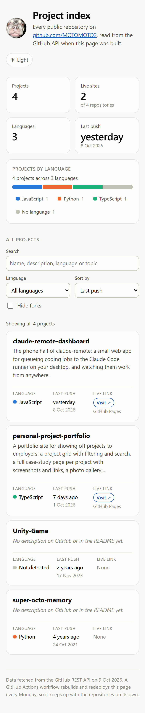

# github-project-index

One page that lists every project on a GitHub account — name, a one-line
description, language, last push, and a live link where there is one.

The list is **read from the GitHub API at build time**, not hand-written, and a
GitHub Actions workflow rebuilds and redeploys the page **every Monday**, so it
cannot quietly go stale.

🔗 **https://adenyadegar.github.io/github-project-index/** — not live yet: this
repository is private, and GitHub Pages needs a paid plan for private
repositories. One switch fixes it; see [Deployment](#deployment).

## What it looks like

The page builds and runs — these are captured from the production build by
`node scripts/screenshot.mjs`, so they are the real thing, not mock-ups.

| Desktop, light | Desktop, dark |
| --- | --- |
|  |  |

<p align="center">
  
</p>

## How it works

```
 GitHub REST API
        │   python scripts/fetch_projects.py
        ▼
 web/src/data/projects.json      ← one JSON document, committed as a snapshot
        │   import (Vite inlines it into the bundle at build time)
        ▼
 React single page  ──►  web/dist  ──►  GitHub Pages
        ▲
        └── .github/workflows/deploy.yml runs all of the above weekly
```

Nothing is fetched in the browser: the visitor downloads a static page with the
data already in it, so there is no API rate limit, no token in the client, and
no loading spinner.

### The data step (Python)

`scripts/fetch_projects.py` uses only the standard library (no pip install in
CI). For each repository it records the name, description, language, topics,
last push, star/fork counts and the archived/fork/private flags, and then fills
two gaps the raw API leaves:

- **Descriptions.** Most repositories have no `description` set, so the script
  falls back to the first real paragraph of the README — skipping the title,
  badges, code fences and HTML comments — and trims it to one sentence of at
  most 180 characters.
- **Live links.** It uses the repository's `homepage` field when there is one,
  otherwise derives the GitHub Pages URL for repositories that have Pages
  enabled. Either way the URL gets an HTTP check, so a dead link is dropped
  rather than published.

### The page (React + TypeScript + Vite)

Search across name/description/language/topics, filter by language, sort by last
push, name or stars, hide forks, and a light/dark theme toggle. A small stat row
and a language-share bar summarise the index; the bar's legend doubles as the
language filter. Colours come from a colourblind-validated categorical palette
and every slice is labelled in text, so nothing depends on colour alone.

## Running it locally

Requires Python 3.9+ and Node 22.12+ (Vite 8 and Vitest 5 need it; CI uses 24).

```bash
# 1. refresh the data (optional: a snapshot is already committed)
python scripts/fetch_projects.py --user adenyadegar

# 2. run the page
cd web
npm install
npm run dev            # http://localhost:5173
```

Other commands, all from `web/`:

```bash
npm run build          # type-check + production build into web/dist
npm run preview        # serve the built output
npm test               # the page's test suite (vitest)
npm run typecheck      # tsc --noEmit
npm run screenshot     # refresh docs/screenshots from the built page
```

And from the repository root:

```bash
python -m unittest discover -s tests -v    # the data layer's test suite
node scripts/screenshot.mjs                # same screenshots, without npm
```

`scripts/screenshot.mjs` builds `web/dist` if it is missing, serves it with
`vite preview`, drives headless Chrome over the DevTools protocol, writes the
three images in `docs/screenshots/`, and stops the server and the browser again
before it exits. It needs Chrome or Edge installed; set `CHROME_PATH` if it is
somewhere unusual. Nothing is left running, so it is safe on a headless box.

67 frontend tests and 33 Python tests cover the description/live-link rules,
the date formatting, the filtering and the rendered page.

## Configuration

`scripts/fetch_projects.py --help` lists everything. The useful flags:

| Flag | Effect |
| --- | --- |
| `--user <login>` | whose repositories to index (default `adenyadegar`, or `$PROJECT_INDEX_USER`) |
| `--output <path>` | where to write the JSON (default `web/src/data/projects.json`) |
| `--token <token>` | API token (default `$GITHUB_TOKEN`); raises the rate limit from 60/hour to 5,000/hour |
| `--include-private` | index private repositories too — needs a personal access token for that account |
| `--exclude-forks` | leave forks out entirely (by default they are listed but labelled) |
| `--no-readme-fallback` | don't read descriptions out of READMEs |
| `--no-link-check` | trust derived live links without an HTTP request |
| `--fallback-to-existing` | on API failure, keep the committed snapshot and mark it stale (used by CI) |

To point the page at a different account, change `--user` in
`.github/workflows/deploy.yml` (it defaults to the repository owner) or set
`PROJECT_INDEX_USER`.

## Deployment

`.github/workflows/deploy.yml` runs on a weekly cron (Mondays, 06:17 UTC), on
every push to `main`, and on demand from the Actions tab. It runs both test
suites, fetches fresh data, builds, and publishes to GitHub Pages.

The workflow asks Actions to enable Pages for the repository on its first run
(`actions/configure-pages` with `enablement: true`).

### The site is not published yet

That first run failed, and the live URL still 404s:

```
Create Pages site failed. Error: Resource not accessible by integration
```

The cause is not the workflow. **This repository is private, and GitHub Pages
for a private repository requires a paid plan** — the API refuses outright:

```
$ gh api -X POST repos/adenyadegar/github-project-index/pages -f build_type=workflow
Your current plan does not support GitHub Pages for this repository. (HTTP 422)
```

Either one of these publishes it, and neither needs a code change:

- **Make the repository public** — `gh repo edit adenyadegar/github-project-index --visibility public`,
  then re-run the workflow. Pages is free for public repositories. (Note this
  publishes the repository's contents; it is left as a deliberate decision
  rather than something the build does for you.)
- **Or upgrade the account to Pro**, and set **Settings → Pages → Source** to
  **GitHub Actions**.

Until then the workflow no longer fails on it. `Configure Pages` is
`continue-on-error`, so the run still fetches, tests and builds, attaches the
built site to the run as the **`site`** artifact, and leaves a warning saying
the page was not published. The `deploy` job skips itself rather than failing.
The moment Pages becomes available, the same workflow deploys with no edit.

Two optional extras:

- **`PROJECT_INDEX_TOKEN` secret** — a personal access token. The workflow uses
  it in preference to the built-in `GITHUB_TOKEN`; add it if you hit the rate
  limit or want `--include-private`.
- **Custom domain / user site** — the build takes its base path from
  `actions/configure-pages`, so a user site (`<login>.github.io`) or a custom
  domain needs no change.

If a scheduled run cannot reach the API, the build reuses the committed snapshot
and the page shows a notice saying the data could not be refreshed, rather than
failing the deploy.

## Layout

```
scripts/fetch_projects.py      GitHub API -> projects.json (stdlib only)
scripts/screenshot.mjs         built page -> docs/screenshots (stdlib only)
tests/test_fetch_projects.py   data-layer tests (unittest)
web/src/App.tsx                the page
web/src/components/            stat row, language share bar, controls, project card
web/src/lib/                   formatting, filtering, language colours, theme
web/src/data/projects.json     generated data, committed as a working snapshot
.github/workflows/deploy.yml   weekly fetch + build + Pages deploy
```

## Notes and assumptions

Choices made while building this that are worth knowing:

- **Public repositories only, by default.** The Actions-provided `GITHUB_TOKEN`
  can only see this repository, so the workflow calls the public
  `/users/{login}/repos` endpoint. Private repositories need a PAT and
  `--include-private`.
- **Forks are included but labelled**, with a "Hide forks" toggle on the page —
  "every project I have" reads as including them.
- **The snapshot is committed** so that `npm run build` works on a clean
  checkout without network access; CI overwrites it before every build.
- **Dates are rendered in UTC**, matching the timestamps GitHub reports.
- **Repository visibility is left alone.** Publishing the page needs this
  repository to be public (or the account on a paid plan). Flipping a private
  repository to public puts its contents on the open internet, so that is a
  decision to make deliberately rather than a step the build takes — see
  [Deployment](#deployment).
- **The screenshots are committed** so the page can be reviewed from the
  repository itself while there is no live URL. `npm run screenshot` regenerates
  them; they are the production build, at 2× scale.
